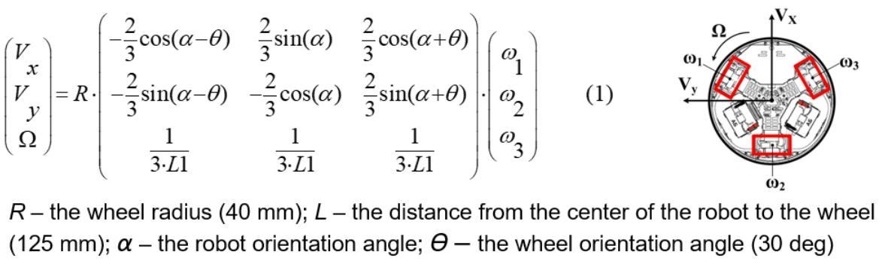
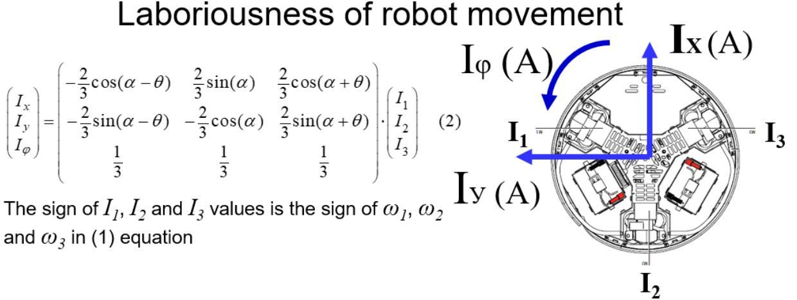
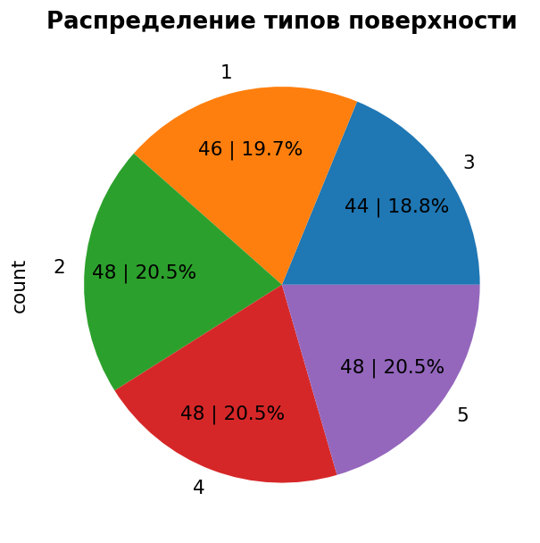
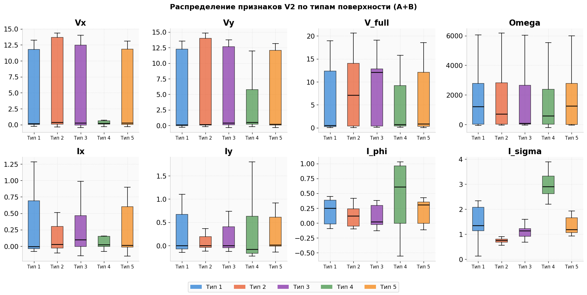
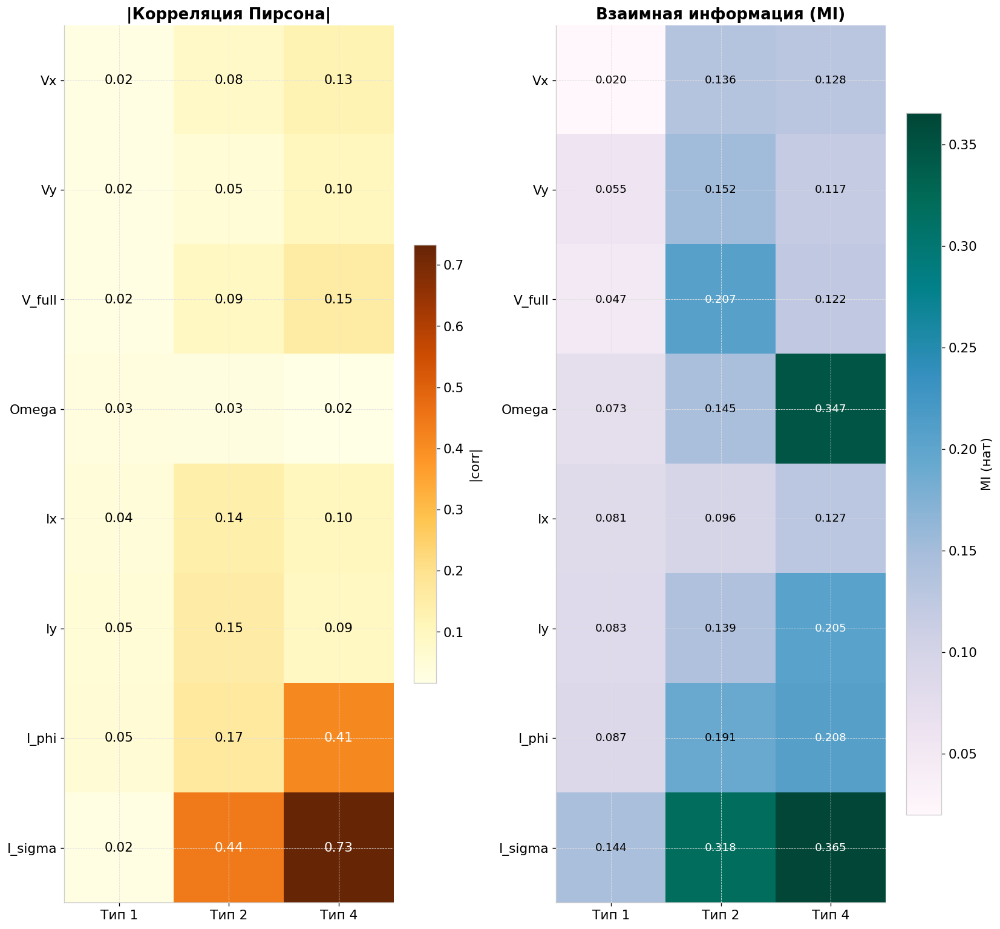
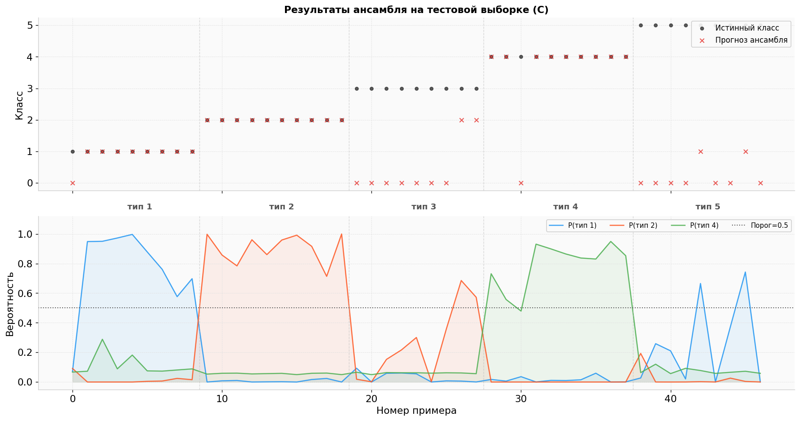
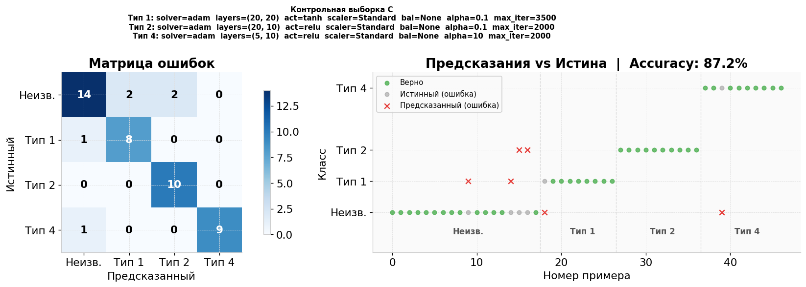

# Ансамбль нейросетевых классификаторов для идентификации типа подстилающей поверхности мобильного робота

Распознавание типа поверхности, по которой движется трёхколёсный омни-робот (Robotino), по показаниям его собственных сенсоров. Задача решается ансамблем из трёх бинарных нейросетевых классификаторов (One-vs-Rest) с отсечкой «неизвестная поверхность».

Проект выполнен как учебный по курсу «Машинное обучение в робототехнике» (НИ ТПУ, направление «Мехатроника и робототехника»).

**Стек:** Python, scikit-learn (`MLPClassifier`), imbalanced-learn, pandas, NumPy, matplotlib, Jupyter.

## Содержание

- [Задача](#задача)
- [Кинематика и динамика робота](#кинематика-и-динамика-робота)
  - [Откуда берутся формулы скорости](#откуда-берутся-формулы-скорости)
  - [Динамика: токи и «трудоёмкость» движения](#динамика-токи-и-трудоёмкость-движения)
- [Данные](#данные)
  - [Признаки](#признаки)
- [Разведочный анализ](#разведочный-анализ)
- [Подход](#подход)
  - [Итоговые параметры](#итоговые-параметры)
  - [Предсказание ансамбля](#предсказание-ансамбля)
- [Результаты](#результаты)
  - [Наблюдения](#наблюдения)
  - [Ограничения](#ограничения)
- [Структура проекта](#структура-проекта)
- [Запуск](#запуск)
- [Визуализация предсказаний ансамбля](#визуализация-предсказаний-ансамбля)

## Задача

Робот движется по террамеханически неоднородной среде, и тип подстилающей поверхности (всего 5 типов) влияет на токи двигателей, скорости колёс и показания инерциальных датчиков. Нужно по этим сигналам определять тип поверхности. В проекте обрабатываются типы **1, 2 и 4**. Поверхности других типов (3 и 5) ансамбль должен относить к классу «неизвестная».

## Кинематика и динамика робота

Robotino — платформа с тремя омни-колёсами, оси которых расположены под углом 120°. Колесо с боковыми роликами свободно скользит поперёк направления вращения, поэтому робот может ехать в любую сторону без предварительного разворота и одновременно вращаться. Состояние движения описывают три величины: линейные скорости $V_x$, $V_y$ и угловая скорость корпуса $\Omega$.

### Откуда берутся формулы скорости

Скорость обода колеса `i` вдоль его оси привода равна проекции скорости точки крепления колеса на эту ось:

$$R\,\omega_i = -\sin\varphi_i \, V_x + \cos\varphi_i \, V_y + L\,\Omega$$

Здесь $R$ — радиус колеса (40 мм), $L$ — расстояние от центра робота до колеса (125 мм), $\varphi_i$ — угол установки колеса. Для трёх колёс получается система $R\,\boldsymbol\omega = J\,\mathbf v$, где $\mathbf v = (V_x, V_y, \Omega)^\top$, а $J$ — квадратная матрица $3 \times 3$. Скорость корпуса по измеренным скоростям колёс даёт обратная задача:

$$\mathbf v = R\,J^{-1}\boldsymbol\omega$$

Для симметричной установки колёс (через 120°) выполняется

$$J^\top J = \mathrm{diag}\left(\tfrac{3}{2},\ \tfrac{3}{2},\ 3L^2\right),$$

поэтому $J^{-1} = (J^\top J)^{-1} J^\top$ состоит из множителей $\tfrac{2}{3}$ и $\tfrac{1}{3L}$. Так получается матрица на рисунке ниже. Угол $\alpha$ (ориентация робота) и $\theta = 30^\circ$ (угол установки колеса) входят в неё через $\cos(\alpha \pm \theta)$ и $\sin(\alpha \pm \theta)$. В проекте $\alpha = 0$.



### Динамика: токи и «трудоёмкость» движения

Момент электродвигателя пропорционален току ($M_i = k_m I_i$), а сила тяги на ободе равна $F_i = M_i / R$. Чтобы держать скорость, привод преодолевает сопротивление поверхности: качение, деформацию грунта, пробуксовку. На «тяжёлой» поверхности при том же движении токи выше, и по ним можно судить о типе поверхности.

Токи колёс проецируются тем же преобразованием, что и скорости (формула (2)). Знак $I_i$ берётся по знаку $\omega_i$, чтобы учитывать направление вращения. Получаются «токовые» компоненты $I_x$, $I_y$ и $I_\varphi$, то есть оценка усилия по осям и вокруг вертикальной оси. Сумма модулей

$$I_\Sigma = \lvert I_1 \rvert + \lvert I_2 \rvert + \lvert I_3 \rvert$$

(в коде `I_sigma`) не зависит от направления движения и показывает общие затраты на перемещение.



*Рисунки взяты из материалов курса «Машинное обучение в робототехнике» (А. А. Андраханов).* Формула (1) выводится из геометрии, как показано выше. Формула (2) по аналогии распространяет то же преобразование на токи и взята из материалов курса без собственного вывода.

## Данные

- `data_set.xlsx`: 234 наблюдения, 15 сенсорных признаков и метка `Type`. Пропусков и дубликатов нет, классы распределены почти поровну (44–48 примеров на класс).
- Сенсорные признаки: токи двигателей `I1–I3`, угловые скорости колёс `V1real–V3real`, энкодеры `N1–N3`, гироскоп `gx–gz`, акселерометр `ax–az`.
- Выборка делится стратифицированно на обучающую **A+B** (187 примеров) и контрольную **C** (47 примеров), `random_state=67`. Разведочный анализ, подбор признаков и параметров выполняются только на A+B, чтобы не допустить утечки данных.
- `D_data.xlsx`: дополнительная независимая выборка (374 наблюдения, типы 3, 4 и 5) для проверки обобщающей способности.



### Признаки

Из сырых показаний по формулам выше ($R = 0.04$, $L = 0.125$, $\theta = 30^\circ$, $\alpha = 0$) вычисляются 8 интегральных признаков:

| Признак | Смысл |
|---------|-------|
| `Vx`, `Vy` | составляющие линейной скорости |
| `V_full` | модуль вектора скорости, $\sqrt{V_x^2 + V_y^2}$ (собственный признак) |
| `Omega` | угловая скорость, $\dfrac{\omega_1 + \omega_2 + \omega_3}{3L}$ |
| `Ix`, `Iy`, `I_phi` | проекции токов |
| `I_sigma` | суммарный ток, $\lvert I_1 \rvert + \lvert I_2 \rvert + \lvert I_3 \rvert$ |

`V_full` добавлен по гипотезе, что максимальная скорость робота зависит от поверхности. В формуле для `Omega` нет множителя $R$, это постоянный масштаб, который `StandardScaler` убирает. Абсолютные значения скоростей зависят от единиц измерения в датасете, поэтому важны их относительные различия между поверхностями.

## Разведочный анализ

Анализ выполнен на обучающей выборке A+B. Для отбора признаков использовались boxplot по типам поверхности, корреляция Пирсона и взаимная информация (MI). Корреляция ловит только линейные связи, а MI находит и нелинейные, которых в физических данных много.



Что видно на boxplot:
- **Токовые признаки различают поверхности лучше скоростных.** `I_sigma` у типа 4 высокий (медиана около 2.9), у типа 2 самый низкий и узкий (около 0.75). Типы 1, 3 и 5 лежат в средней зоне и частично перекрываются.
- **`Vx`, `Vy`, `V_full`, `Omega` перекрываются у всех типов.** Распределения скошены, медианы близки к нулю: большую часть времени робот стоит или разгоняется. Исключение: `Vx` на типе 4 почти нулевой и очень узкий.
- **У типа 4 `I_phi` выше и шире, чем у остальных.** Это согласуется с большими затратами на движение по такой поверхности.



Что видно на тепловых картах:
- **Тип 4** хорошо выделяется суммарным током: $\lvert r \rvert = 0.73$ для `I_sigma` и 0.41 для `I_phi`. По `Omega` корреляция почти нулевая (0.02), а MI высока (0.347), то есть зависимость нелинейная.
- **Тип 2** тоже связан с `I_sigma` ($\lvert r \rvert = 0.44$, MI 0.318).
- **Тип 1** линейно почти не связан ни с одним признаком ($\lvert r \rvert \le 0.05$), но MI для `I_sigma` у него 0.144. Токи этого типа лежат между типами 2 и 4, поэтому порог по одному признаку его не отделяет. Это согласуется с тем, что у типа 1 самый низкий F1.

Признаков немного, поэтому в итоге оставлены все восемь: при выборе подмножества можно потерять полезную информацию.

## Подход

Для каждого типа поверхности обучается свой бинарный `MLPClassifier` («этот тип» против «остальных»). Параметры подбирались последовательно, на каждом шаге предыдущие фиксировались. Критерий выбора: F1 на 3-блочной кросс-валидации (среднее и разброс).

Базовая конфигурация: решатель `adam`, `StandardScaler`, один скрытый слой на 20 нейронов, без балансировки. Решатель `lbfgs` отбросили, потому что он не сходился.

Порядок подбора:
1. Коэффициент L2-регуляризации `alpha`: 0.0001, 0.001, …, 100.
2. Функция активации: `relu`, `tanh`, `logistic`, `identity`.
3. Архитектура: 24 варианта (1–3 скрытых слоя по 5–40 нейронов).
4. Скейлер (`StandardScaler`, `MaxAbsScaler`, `MinMaxScaler`) вместе с балансировщиком (без него, `SMOTE`, `ADASYN`).

Дополнительно проверялось, влияет ли порядок подачи обучающих примеров на результат. Не влияет: выборка (187 примеров) меньше размера батча по умолчанию (200), поэтому `adam` считает градиент по всей выборке сразу.

### Итоговые параметры

| Тип | Архитектура | Активация | `alpha` | `max_iter` | Скейлер | Балансировка |
|-----|-------------|-----------|---------|------------|---------|--------------|
| 1 | (20, 20) | tanh | 0.1 | 3500 | StandardScaler | нет |
| 2 | (20, 10) | relu | 0.1 | 2000 | StandardScaler | нет |
| 4 | (5, 10) | relu | 10 | 2000 | StandardScaler | нет |

Во всех случаях решатель `adam`, входные признаки: 8 величин из таблицы выше.

### Предсказание ансамбля

Каждый классификатор возвращает вероятность своего типа. Выбирается тип с максимальной вероятностью. Если она меньше 0.5, поверхность считается неизвестной (класс 0).

## Результаты

Метрики F1 для отдельных классификаторов (бинарная задача):

| Тип | F1 на A+B | CV F1 (3 блока) | F1 на контрольной выборке C |
|-----|-----------|-----------------|------------------------------|
| 1 | 0.870 | 0.794 ± 0.034 | 0.84 |
| 2 | 0.946 | 0.856 ± 0.062 | 0.91 |
| 4 | 0.882 | 0.860 ± 0.081 | 0.95 |

Ансамбль на контрольной выборке C (47 примеров; класс «Неизв.» объединяет поверхности 3 и 5):

| Класс | Precision | Recall | F1 | Объекты |
|-------|-----------|--------|----|---------|
| Неизв. | 0.88 | 0.78 | 0.82 | 18 |
| Тип 1 | 0.80 | 0.89 | 0.84 | 9 |
| Тип 2 | 0.83 | 1.00 | 0.91 | 10 |
| Тип 4 | 1.00 | 0.90 | 0.95 | 10 |

Общая точность 0.87, macro F1 0.88.

### Наблюдения

- Хватает небольших сетей с двумя скрытыми слоями. Увеличение числа нейронов ухудшало качество.
- `StandardScaler` оказался лучшим для всех трёх классификаторов.
- Балансировка (`SMOTE`, `ADASYN`) не дала выигрыша.
- `tanh` лучше для типа 1, `relu` для типов 2 и 4.
- Для типа 4 нужна сильная регуляризация (`alpha = 10`).

### Ограничения

- Выборка небольшая (187 обучающих примеров), поэтому оценки F1 заметно колеблются между фолдами кросс-валидации (до ±0.08).
- На независимой выборке D (типы 3, 4, 5) результат хуже: общая точность 0.63. Тип 4 находится с recall 0.54 (precision 0.97), а поверхности 3 и 5 правильно помечаются «неизвестными» в 68 % случаев. Отсечка по вероятности 0.5 неидеальна: ансамбль не обучался распознавать «чужие» поверхности и узнаёт их только по низкой уверенности.

## Структура проекта

| Путь | Назначение |
|------|------------|
| `lb1.ipynb` | Основной ноутбук: анализ данных, подбор параметров, обучение и оценка ансамбля |
| `data_set.xlsx` | Основной датасет |
| `D_data.xlsx` | Независимая проверочная выборка |
| `images/` | Рисунки для README |
| `models/` | Обученные модели ансамбля (`ensemble_type_{1,2,4}.joblib`), создаются ячейкой сохранения в ноутбуке |

## Запуск

```bash
pip install numpy pandas matplotlib scikit-learn imbalanced-learn openpyxl jupyter
jupyter notebook lb1.ipynb
```

Файлы `data_set.xlsx` и `D_data.xlsx` должны лежать рядом с ноутбуком. Выполняйте ячейки по порядку. Для воспроизводимости везде используется `SEED = 67`.

## Визуализация предсказаний ансамбля

Ниже результаты ансамбля на контрольной выборке C. На верхней панели истинный класс и прогноз для каждого примера, на нижней вероятности трёх классификаторов с порогом 0.5. Примеры отсортированы по истинному типу, классы 3 и 5 для ансамбля «чужие» и должны получать метку 0 (неизвестная поверхность).



На выборке C 87.2 % примеров определены верно. Все примеры типа 2 найдены, у типа 4 один пример ушёл в «неизвестные», у типа 1 тоже один. Из 18 «чужих» поверхностей четыре ошибочно приняты за тип 1 или 2.


